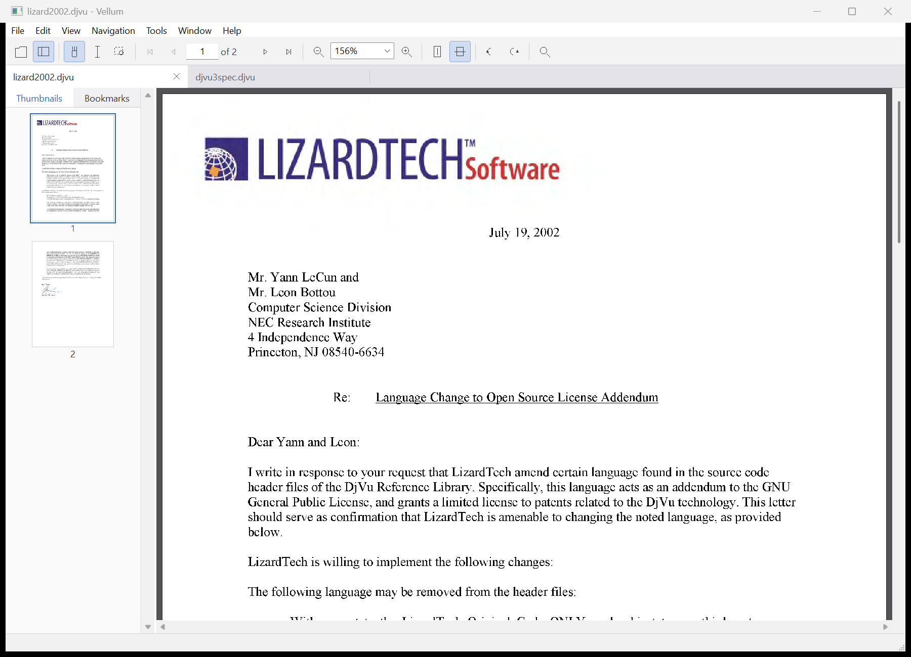

# Vellum

A PDF, DjVu and image viewer for Windows, in C++20.

It reproduces the way Adobe Acrobat's viewer behaves — the same zoom and
fit modes, the same six page layouts, the same hand/select/marquee tools,
thumbnails and bookmarks in a navigation pane, find-as-you-type, text
selection and copy — and adds DjVu, which Acrobat does not read at all.

PDF rendering uses PDFium. **DjVu is decoded by this project**: the IFF
container, the ZP arithmetic coder, BZZ, the JB2 bitonal codec and the
IW44 wavelet codec are all implemented here, from the format definition.
Still images (JPEG, PNG, GIF, BMP, TIFF, and WebP/HEIF where Windows
supports them) go through the Windows Imaging Component.

Opening a picture opens its **folder**: every image beside it becomes a
page, sorted the way Explorer sorts them, so next and previous step
through the directory and the thumbnail pane becomes a contact sheet.

Documents open in **tabs**. Browsing for a file opens it beside what is
already open rather than replacing it, and each tab keeps its own page,
zoom, layout, rotation, selection and search, so switching back lands you
exactly where you left off.



---

## Build

Needs Visual Studio 2022 (or the 2026 Build Tools), CMake 3.20+ and Ninja.
PDFium is vendored in `third_party/pdfium`.

```powershell
.\build.ps1                     # RelWithDebInfo into .\build
.\build.ps1 -Config Debug
.\build.ps1 -Target vellum_probe
.\build.ps1 -Clean
```

`build.ps1` finds a Visual Studio installation, imports its environment and
drives CMake. To configure by hand instead, run from a developer prompt:

```
cmake -S . -B build -G Ninja -DPDFIUM_ROOT=third_party/pdfium
cmake --build build
```

Without `PDFIUM_ROOT` the build still succeeds and produces a DjVu-only
viewer.

## Test documents

The corpus is not committed — it belongs to the DjVuLibre project, not to
this one. Fetch it once after cloning:

```powershell
.\tools\fetch-samples.ps1
```

That downloads the DjVu v2 and v3 specifications, the DjVuLibre manual in
English and Russian, and two scanned letters (219 pages between them,
covering bitonal masks, shared dictionaries, IW44 colour backgrounds,
hidden text and outlines), and generates a small PDF of its own so the PDF
back end has something to open.

## Use

```
vellum.exe                      # empty, use File > Open
vellum.exe document.pdf
vellum.exe scan.djvu
vellum.exe photo.jpg            # opens the whole folder, starting here
vellum.exe a.pdf b.djvu c.png   # one tab each
```

Drag and drop works, as does opening from Explorer.

### Keys

| | |
|---|---|
| `Ctrl+O` | open in a new tab |
| `Ctrl+Shift+O` | open in the current tab |
| `Ctrl+W`, `Ctrl+F4` | close tab |
| `Ctrl+Tab`, `Ctrl+Shift+Tab` | next / previous tab |
| `Ctrl+0` `Ctrl+1` `Ctrl+2` `Ctrl+3` | fit page, actual size, fit width, fit visible |
| `Ctrl++` / `Ctrl+-` | zoom in / out |
| `Ctrl+Shift++` / `Ctrl+Shift+-` | rotate clockwise / counterclockwise |
| `Ctrl+Home` / `Ctrl+End` | first / last page |
| `PgUp` `PgDn` `Space` arrows | scroll; turns the page at the edge in single-page modes |
| `Ctrl+F`, `F3`, `Shift+F3` | find, next, previous |
| `H` `V` `Z` | hand, select text, marquee zoom |
| `F4` | show/hide the navigation pane |
| `Ctrl+L` | full screen (`Esc` leaves) |
| `Ctrl+C` / `Ctrl+A` | copy selection / select page text |
| `Ctrl+D` | document properties |

Mouse: wheel scrolls, `Ctrl`+wheel zooms about the pointer, the hand tool
drags, the marquee tool zooms to a dragged rectangle (click to step zoom,
`Ctrl`+click to step out). Middle-clicking a tab closes it.

## Command-line harness

`vellum_probe` drives the back ends with no UI, which is how the decoders
are tested:

```
vellum_probe info   <file>                               structure + outline
vellum_probe text   <file> [page]                        extracted text
vellum_probe render <file> <page> <width> <out.ppm> [rot]
vellum_probe all    <file> <width> <out-dir>             every page
```

`tools/ppm2png.py` converts the output for viewing;
`tools/screenshot.ps1` launches the viewer and captures its window.

---

## Layout

The separation follows Acrobat's: a platform layer, a format layer, a
document model, and a viewer that knows only the document model. That is
what lets one viewer serve two unrelated formats.

```
src/
  core/        bytes, bitmaps, geometry           (Acrobat's AS layer)
  djvu/        iff zp bzz jb2 iw44 document       DjVu, implemented here
  pdf/         document.cpp                       PDFium adapter
  image/       document.cpp                       JPEG/PNG/... via WIC
  doc/         document.h                         the model the UI sees  (PD)
  view/        layout.cpp  render_cache.cpp       page placement, async render
  ui/          main_window toolbar tab_bar
               nav_pane page_view find_bar app    the viewer              (AV)
tests/         unit tests, fixtures, a fake Document
tools/         probe.cpp, generators, sample fetch, capture, coverage
third_party/   pdfium
samples/       DjVu and PDF test documents
docs/          reverse-engineering.md
```

### How a page reaches the screen

```
LayoutEngine ── page rectangles in document space
      │
PageView paints ── asks RenderCache for each visible page
      │                      │
      │              worker thread ── Document::Render ──┬── PdfDocument   → PDFium
      │                      │                           ├── DjvuDocument  → JB2 + IW44
      │                      │                           └── ImageDocument → WIC
      └── blits the BGR bitmap, or scales another size while waiting
```

Three decisions carry most of the weight:

* **Rendering never happens on the UI thread.** A worker renders into an
  LRU cache and posts a message; the view paints what is ready and scales a
  different size meanwhile, so scrolling never blocks. Visible pages are
  prioritised over prefetched ones, and requests for pages that have
  scrolled away are dropped before they start.
* **Bitmaps are 24-bit BGR with 4-byte-aligned rows.** That is exactly what
  a Windows DIB and PDFium's `FPDFBitmap_BGR` both want, so a rendered page
  reaches the screen without a single per-pixel conversion.
* **Text positions are normalised to the page.** Selection and search
  results are stored as fractions of the page box, so they survive zoom,
  rotation and layout changes without recomputation.
* **A "page" is whatever the backend says it is.** Nothing above the
  document model knows a page might be a separate file, which is why a
  folder of pictures gets thumbnails, a page box, zoom, rotation and
  next/previous without a line of image-specific UI code.
* **A tab owns a document and everything about how it is being read.**
  The windows render whichever tab is active, so switching is a pointer
  change rather than a save-and-restore of a dozen fields. Each tab has
  its own render cache, which bounds memory per document rather than per
  process.

### DjVu decoding

```
AT&T ─ FORM:DJVM ─┬─ DIRM  ── BZZ ── the page/component directory
                  ├─ NAVM  ── BZZ ── the outline
                  ├─ FORM:DJVI ── Djbz ── shape dictionary shared by pages
                  └─ FORM:DJVU ─┬─ INFO
                                ├─ INCL  ── names the dictionary above
                                ├─ Sjbz  ── JB2  ── the bitonal mask
                                ├─ BG44  ── IW44 ── background
                                ├─ FG44  ── IW44 ── foreground
                                └─ TXTz  ── BZZ  ── hidden text
```

The mask is composed at a resolution close to the output, which both
anti-aliases the ink and avoids decoding a 300 dpi page to show it at 90.
Shared dictionaries are decoded once and cached across pages.

Supported: `DJVM`/`DJVU`/`DJVI`, `DIRM`, `NAVM`, `INFO`, `INCL`, `Djbz`,
`Sjbz`, `BG44`, `FG44`, `TXTa`, `TXTz`.
Not implemented: `Smmr` (MMR masks), `BGjp`/`FGjp`, `BG2k`/`FG2k`, `FGbz`
palettes, `ANTa`/`ANTz`. A page using one of these renders from the layers
that are supported instead of failing.

## Testing

```powershell
.\build.ps1
.\tools\fetch-samples.ps1        # once, for the codec tests
.\build\vellum_tests.exe
```

120 test cases, 7,743 assertions, about two seconds. Most of the suite is
hermetic: BMP, TIFF, PDF and IFF containers are simple enough to build in
memory, so they are constructed by the fixtures rather than committed.
The JB2 and IW44 tests need real encoded streams and use the fetched
corpus, skipping with a note when it is absent.

What the tests are actually pinning down, beyond line counts:

* **Channel order**, against a documented producer. A PDF painted pure red
  must arrive as `(0, 0, 255)`, because `Pixmap` is BGR. An eye on a
  downscaled screenshot is not a good enough check for this, as an earlier
  swapped-channel export in the probe demonstrated.
* **Row padding.** Rasters pad to four bytes, and a page whose width is not
  a multiple of four would otherwise shear when GDI blits it.
* **Malformed input.** Real documents are truncated at forty points,
  byte-flipped sixty times, and have their chunk lengths set to absurd
  values; every case must open or report an error, never crash or hang.
* **Layout against the document model.** A fake Document supplies pages of
  differing sizes, so the fit modes, two-up spreads and mixed-orientation
  centring are checked without decoding anything.
* **The render cache's threading**: eviction under a budget, dropped
  requests, a backend that throws, and destruction with work outstanding.

### Coverage

```powershell
.\tools\coverage.ps1             # add -Html for an annotated report
```

Uses clang-cl's source-based instrumentation and `llvm-cov`, building into
`build-coverage/` so the ordinary MSVC build is untouched. The script picks
the newest MSVC toolset the installed Clang can actually compile against,
since the MSVC standard library refuses an older one.

Current figures, for everything except the Win32 windows:

| | |
|---|---|
| Lines | **94.2%** (176 of 3,007 missed) |
| Functions | **98.0%** |
| Regions | 90.8% |
| Branches | 80.4% |

The `src/ui/` layer is excluded rather than counted as missed. Its ~4,000
lines are window procedures and GDI painting that need a message loop, a
desktop and a focused window; `tools/screenshot.ps1` drives the real
application instead, launching it with documents and injecting commands.
Most of what remains uncovered elsewhere is error handling that needs the
operating system to fail: a read that returns short, a file that cannot be
sized.

## Licensing

Project code is MIT (`LICENSE`). PDFium is BSD-3-Clause
(`third_party/pdfium/LICENSE`); `pdfium.dll` ships beside the executable.

The DjVu decoder is an independent implementation written against the
format definition, for interoperability. Its three constant tables (the ZP
adaptation table and IW44's quantization and zigzag tables) are data
definitions of the bitstream, without which no conforming file can be
decoded; they are extracted mechanically by the scripts in `tools/` rather
than transcribed, so their provenance stays explicit.

Test documents are not redistributed here; `tools/fetch-samples.ps1`
downloads them from the DjVuLibre project, where they carry their own
terms.

## Notes

`docs/reverse-engineering.md` records what was examined in Acrobat
26.002.21931 and in the DjVu format, what the evidence does and does not
support, and which design decisions here came from which observation.
